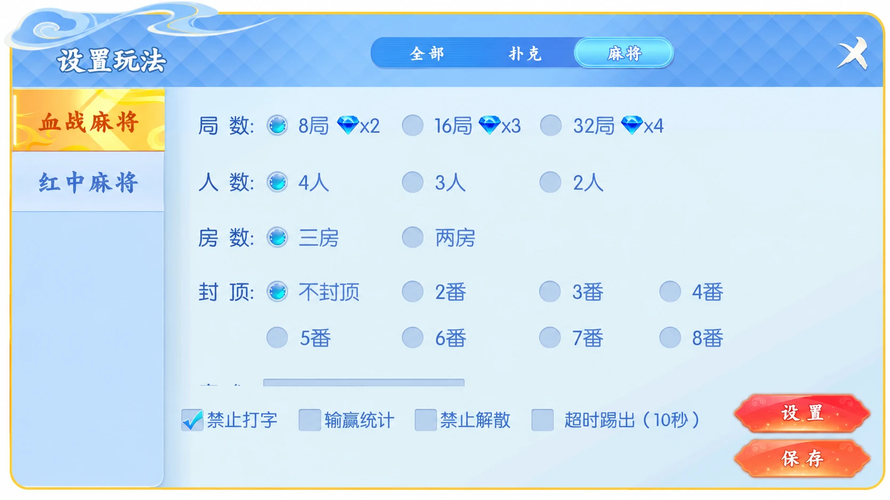

# 四友联盟：房间配置的字段白名单

四友联盟提供俱乐部、创建房间、加入房间、规则与战绩入口，包含跑得快、血战麻将、红中麻将等玩法。房间设置采用分类标签、单选项和复选框组合。本篇以配置提交为例，说明服务端如何接收明确允许的字段。

## 大厅


## 房间设置



配图经过AI编辑：大厅账号已替换，设置图只展示弹窗区域；局部展示不表示其他功能已移除。

## 字段白名单

客户端隐藏一个按钮，不代表请求中不会出现相关字段。接口不能把整个请求对象直接合并进房间配置，而应明确规定允许哪些字段、字段类型是什么、哪些字段必须同时提供。

本例只接收禁止聊天与显示统计两个布尔值。未知字段直接报错，字符串`"false"`也不会被当成布尔值处理。这两个字段是教学命名，不是原项目接口定义。

```js
// 独立教学示例，只处理两个布尔配置项。
export function validateOptions(input) {
  if (!input || typeof input !== 'object' || Array.isArray(input))
    throw new TypeError('需要配置对象');
  const allowed = ['chatDisabled', 'showStats'];
  for (const key of Object.keys(input)) {
    if (!allowed.includes(key)) throw new Error('未知配置字段');
    if (typeof input[key] !== 'boolean') throw new TypeError('字段必须为布尔值');
  }
  for (const key of allowed) {
    if (!Object.hasOwn(input, key)) throw new Error('缺少配置字段');
  }
  return {chatDisabled:input.chatDisabled, showStats:input.showStats};
}
```

返回对象只包含白名单字段，与输入对象分离。调用方可以保存结果，避免把额外属性或原型链上的属性带入持久化数据。该实现面向JSON解析后的普通对象，不应直接处理携带访问器或代理行为的任意JavaScript对象。

## 配置更新

字段校验和身份校验是两件事。接口还应验证操作者对当前房间的管理权限，再判断房间是否处于允许修改的阶段。需要处理并发更新时，可附带配置版本号，在同一次事务中比较版本并保存。

白名单不应包含改变玩家牌面、指定胜负或伪装机器人身份的字段。普通房间管理权限不能成为操控对局结果的入口。本文不实现或提供控制输赢、解除授权、解密工具或交易功能，也不表示原组件已移除这些能力。

## 示例验证

实现见 [options.mjs](options.mjs)，测试见 [test.mjs](test.mjs)。安装支持`Object.hasOwn`的Node.js后运行：

```sh
node test.mjs
```

8项断言验证正常配置、未知字段、错误类型、字段缺失、空值、数组、继承属性及对象隔离。代码为独立教学示例，不是原游戏源码。

## 技术交流

[Telegram @root4433](https://t.me/root4433)
